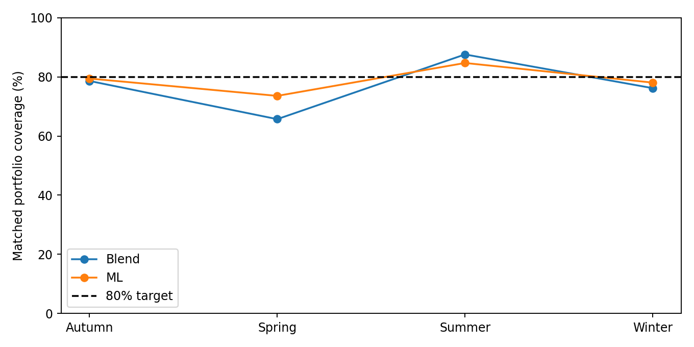
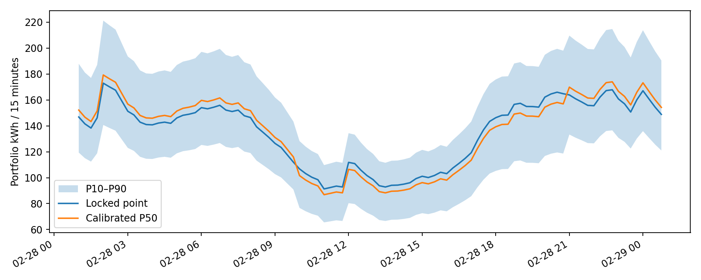

# Step 5 — frozen empirical uncertainty

Both locked point forecasts are preserved. No electricity or weather model was trained, retuned or replaced. TEST outcomes were read only after the validation calibration lock was saved. PointForecast remains separate from the residual-corrected P50.

Calibration uses TRAIN-only model predictions on the annual validation period. Each prequential validation day uses residual days strictly before D−1 (conservative relative to the 11:00 issue). The first 60 days are warm-up. Temperature conditioning (<5°C, 5–15°C, ≥15°C) requires 30 distinct days and otherwise falls back to pooled residuals; the candidate with lower prequential interval score is selected separately for ML and blend. Selection targets interval quality, not a new point-model benchmark.

Portfolio residuals are normalized by matched forecast demand, so widths scale with forecast demand. This is an empirical scaling hypothesis rather than a formal conformal guarantee. Daily quantiles use complete 96-interval historical daily residual sums: they are not sums of interval or household quantiles. Shared weather errors are already present in these aggregate residuals.

Full-portfolio scenarios add four targetless-household proxy errors using the mean history-withheld established-household residual at the same historical timestamp/day as the portfolio residual. This preserves common time/weather shocks, but averaging understates idiosyncratic variation for only four homes; full-portfolio bounds are provisional. Direct ground truth for these four homes does not exist. TEST coverage therefore refers only to the retrospective matched measured subset, not the full portfolio.

| Method | Validation interval coverage | TEST interval coverage | TEST mean width kWh | Validation daily coverage | TEST daily coverage | TEST daily width MWh |
|---|---:|---:|---:|---:|---:|---:|
| ML | 80.3% | 79.0% | 47.57 | 77.8% | 73.4% | 3.058 |
| Blend | 81.1% | 77.0% | 45.06 | 78.5% | 74.5% | 2.821 |

Validation assessment covers the post-warm-up period, rather than all 365 days; spring coverage is limited. Both final test and validation zero-support days are excluded from scoring, and the partial embargoed validation day is excluded from daily calibration. Missing measurements remain missing. Matched support changes over time, and applying relative residuals to a growing roster assumes aggregate error scaling remains transferable.

Condition-level results are in coverage_by_condition.csv (season, temperature, demand thirds learned from validation, hour and weekday/weekend). Heating exposure is deterministically tied to predicted temperature; it is not independent evidence. Validation residual diagnostics report absolute and relative error by conditions. Station mixtures change with roster, but there are too few independent annual/station exposure changes to justify an additional station-specific calibrator. Predicted temperature summarizes the mixture; it does not eliminate station assignment or weather forecast uncertainty.

Individual unseen-day marginal intervals use state and demand bands from a deterministic every-sixteenth-row validation sample. Targetless households use cold proxy residuals from established households predicted without personal consumption history. Sparse and cold residual limits are widened to at least the established limits in the same point band before nonnegative clipping. The deterministic sample primarily covers six UTC slots per household/day; it is not a complete individual intraday calibration. These individual intervals have not received a separate out-of-time coverage benchmark and should be treated as provisional diagnostics. They are never summed to produce portfolio quantiles.

Validation evidence (ML):

| Condition | Group | Mean absolute error kWh | Mean absolute relative error |
|---|---|---:|---:|
| TemperatureBand | Cold (<5C) | 19.11 | 14.2% |
| TemperatureBand | Mild (5-15C) | 10.99 | 15.9% |
| TemperatureBand | Warm (>=15C) | 4.19 | 10.9% |
| DemandBand | Low | 4.69 | 13.1% |
| DemandBand | Medium | 7.80 | 13.8% |
| DemandBand | High | 19.88 | 14.6% |

Station diagnostics are available in validation_station_diagnostics.csv; these household errors combine weather, household composition and metadata effects and cannot establish a causal station effect. No station-specific calibration was selected.

TEST ML differences (matched measured support):

| Condition | Group | Coverage | Mean width kWh |
|---|---|---:|---:|
| Season | Autumn | 79.5% | 42.20 |
| Season | Spring | 73.6% | 49.67 |
| Season | Summer | 84.7% | 18.34 |
| Season | Winter | 78.1% | 80.70 |
| TemperatureBand | Cold (<5C) | 79.0% | 82.78 |
| TemperatureBand | Mild (5-15C) | 77.7% | 50.82 |
| TemperatureBand | Warm (>=15C) | 80.6% | 17.80 |
| DemandBand | High | 78.0% | 64.75 |
| DemandBand | Low | 89.0% | 12.82 |
| DemandBand | Medium | 79.8% | 20.78 |

Confirmed: point weights, saved forecasts, chronological splits and calibration lock are unchanged. Exploratory evidence: temperature conditioning improved validation interval score, and the table documents TEST seasonal/demand differences without retuning. Modelling hypotheses: relative error transfer across roster sizes and pooled cold proxies represent unseen households sufficiently well; neither is fully verified for the targetless homes.

## February 28, 2024

| Method | Point MWh | P10 MWh | P50 MWh | P90 MWh |
|---|---:|---:|---:|---:|
| ML | 13.014909 | 10.470 | 12.381 | 14.681 |
| Blend | 12.714074 | 10.959 | 12.641 | 14.444 |

ML peak: 2024-02-28 01:00:00+00:00 (02:00 Europe/Berlin), point 172.94 kWh, P90 221.24 kWh, P10–P90 width 80.55 kWh. These are interval energy values, not kW; multiply by four for average power.

The intervals represent demand uncertainty, not market-price scenarios. A simple decision layer can use P50 as a central demand quantity and consider quantities toward P90 when shortage imbalance costs dominate surplus costs. P50 itself is not inherently a lower-risk purchase; the appropriate quantile depends on the cost asymmetry. No purchasing optimization was implemented.

Outputs: 2024-02-28_ML_portfolio.csv and 2024-02-28_Blend_portfolio.csv (96 rows each); test_daily_quantiles.csv; test_portfolio_quantiles.parquet; 2024-02-28_household_quantiles.parquet; calibration_lock.json; household_calibration.json; test_evaluation_complete.json; coverage_by_condition.csv and validation_residual_diagnostics.csv. The JSON contains daily quantiles and peak statistics.

Limitations: only one annual residual history, temporal dependence, roster/missing-support changes, unverified targetless demand, possible outdated metadata, no station-mixture-specific calibration, and no guarantee of simultaneous coverage across all 96 intervals. Daily coverage is separately measured. Daily P50 is not the sum of quarter-hour P50 values: medians do not add, and the daily residual distribution is calibrated separately. UTC delivery days contain 96 intervals; the figure uses Europe/Berlin local time (01:00 to next-day 00:45 for February 28). TEST shortfalls are reported without any recalibration.

Daily TEST coverage (ML 73.4%, blend 74.5%) falls below the nominal 80%; spring quarter-hour coverage is also weak. Together with the provisional targetless-household contribution, this prevents procurement-ready coverage claims. The files are usable for an explicitly provisional decision prototype. No adjustment was made after TEST evaluation.

READY FOR PROCUREMENT DECISION STEP: NO
