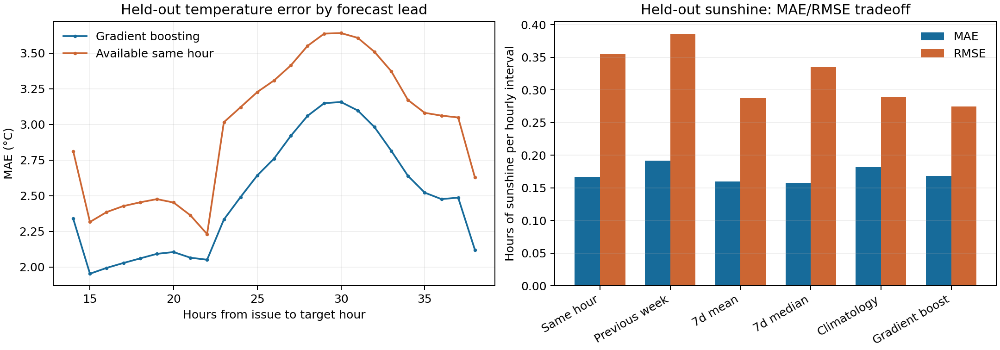
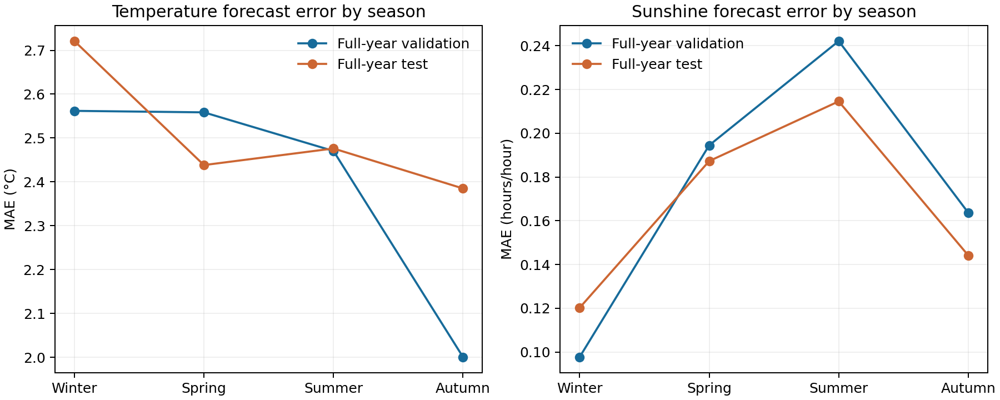

# Weather forecasting step: chronological split and locked results

This revised step implements station-level WEATHER forecasts only. No electricity/grid-import model was fitted, no household forecasting features were regenerated, and raw data/Step 2 outputs were not modified. Split choice used the existing preprocessing audit rather than a fresh data audit.

## 1. Exact frozen global split

| Period | UTC delivery dates inclusive | Days | Share |
| --- | --- | ---: | ---: |
| Training | 2019-05-20–2022-02-27 | 1015 | 58.17% |
| Validation | 2022-02-28–2023-02-27 | 365 | 20.92% |
| Final test | 2023-02-28–2024-02-27 | 365 | 20.92% |

Actual meter-date span is 1745 days. The user's explicit request for complete seasonal coverage superseded the approximate 70/10/20 convention: the latest full 365-day year is test, the preceding full year validation, and older dates training. These dates are now frozen in `ChronologicalSplit` in src/config.py and splits.json. The first run remains under outputs/weather_forecasting; this revised run is under outputs/weather_forecasting_full_year. The revised test overlaps previously viewed weather results, so it is excluded from revised fitting/selection but cannot be described as never inspected. Features/model parameters remain unchanged; the split change was requested for season coverage, not chosen by comparing test performance.

Both holdouts contain all 12 months and all four meteorological seasons:

| Season | validation | test |
| --- | --- | --- |
| DJF | 90 | 90 |
| MAM | 92 | 92 |
| JJA | 92 | 92 |
| SON | 91 | 91 |

These full-year windows are anchored to the latest observed demand date, not January–December calendar years. Boundary-day embargoes below only remove unavailable selection labels, not complete seasons. Existing audit file-span coverage at the two boundaries is {'2022-02-27': 173, '2023-02-27': 394}; this is not a fresh household audit. Weather begins 2019-01-01; older weather serves as input warm-up history, not extra future training/validation labels. All eight stations share the split; no random time split is used.

**Boundary availability embargo:** chronological target dates alone do not guarantee labels were known by the first next-period issue. Training labels are restricted to **2022-02-27 08:00:00+00:00** before the first validation issue. Validation model selection and train+validation refit stop at **2023-02-27 08:00:00+00:00**, before the first test issue **2023-02-27 10:00:00+00:00**. Late boundary-day labels remain outside fitting/selection. The global date boundaries are unchanged. Validation scores below cover the available selection subset, not the embargoed final hours of February 27.

## 2. Weather variables modelled

- Temperature_avg_hourly: temperature in °C, all eight stations.
- Sunshine_duration_hourly: sunshine duration in hours per hourly interval, five stations.
- Humidity_avg_hourly: relative humidity in percent, all eight stations.

Pressure, precipitation and wind are not modelled in this first version. These are optional future candidates, not inputs backed by this validation.

All forecasts use **11:00 Europe/Berlin on D−1**, forecasting the **24 UTC hourly intervals of D**. Historical hourly timestamps are conservatively treated as interval starts with one-hour observation latency, so the last permissible start is **issue minus two hours**. Target-day observations and later D−1 observations never enter features. Forecast lead is 14–37 hours in winter or 15–38 hours in summer, with DST handled by the timezone-aware issue timestamp.

## 3. Baselines tested

1. Most recent observed matching UTC hour, at/before the cutoff; afternoon targets usually need an older date than morning targets.
2. Previous-week matching UTC hour; missing if that exact hourly value is absent.
3. Trailing seven-day same-hour mean.
4. Trailing seven-day same-hour median.
5. Training-only station/month/UTC-hour climatology, falling back to station/hour then station mean when a seasonal bin is absent.

Weather diurnal matching uses UTC hour to avoid an artificial DST clock shift in solar/weather cycles. Both UTC/local hour and seasonal calendar are supplied to ML. Seven-day same-hour windows end at the most recent matching hour permitted by cutoff; there is no future fill. Each method shares training-only bounds/night handling for a fair comparison.

## 4. Selected weather model and lock

A pooled **HistGradientBoostingRegressor** was trained separately for each variable, with station as a categorical feature. There are **55 inputs**, not an exhaustive interaction expansion: station, target UTC/local hour, target month/day of year, lead, cyclic hour/year; and three variables' latest values/age, 6/12/24-hour means/coverage, 24-hour standard deviation, six-hour change, previous-week hour, available hour/age, seven-day same-hour mean/median. No actual target weather is an input. The exact whitelist is in weather_feature_contract.json.

Parameters fixed before test: 120 iterations, learning rate 0.06, 15 leaf nodes, minimum leaf sample count 40, L2=1, seed=42, **early_stopping=False** (no random internal validation split). There was one practical model configuration, not a test-driven hyperparameter search.

Validation selection uses **lowest MAE on common observed support across all six candidates**, with RMSE only a tie-break. Model choices were written to model_selection_lock.json before test labels/metrics were requested:

| Variable | Locked method |
| --- | --- |
| Temperature | hist_gradient_boosting |
| Sunshine | available_same_hour |
| Humidity | hist_gradient_boosting |

The selected sunshine method is **available_same_hour**, chosen on the revised full-year validation MAE. All baseline/ML RMSE differences are reported; none triggers test-based reselection. The previous mostly-winter validation winner is not automatically retained. Test-model weights were refitted using only train+validation weather available at the first test cutoff, then frozen throughout test. Later test-period observed history can enter rolling inputs when available, as it would operationally; it never updates the test-model weights.

## 5. Validation performance

| Period | Variable | Units | n | MAE | RMSE | Bias |
| --- | --- | --- | --- | --- | --- | --- |
| validation_selection | Temperature_avg_hourly | °C | 69824 | 2.398 | 3.062 | -0.297 |
| validation_selection | Sunshine_duration_hourly | hours/hour | 43725 | 0.175 | 0.369 | 0.002 |
| validation_selection | Humidity_avg_hourly | percentage points | 69824 | 8.906 | 11.777 | 0.732 |

## 6. Held-out test performance

| Period | Variable | Units | n | MAE | RMSE | Bias |
| --- | --- | --- | --- | --- | --- | --- |
| test | Temperature_avg_hourly | °C | 69840 | 2.504 | 3.205 | -0.425 |
| test | Sunshine_duration_hourly | hours/hour | 43800 | 0.167 | 0.355 | -0.000 |
| test | Humidity_avg_hourly | percentage points | 69840 | 8.432 | 11.034 | 0.317 |

Units: sunshine hours/hour (multiply MAE by 60 for minutes); humidity percentage points. Selected-method scores use every finite actual/predicted pair. Temperature/humidity cover all observed targets. Common-support comparison below uses identical rows per variable for model comparison; it differs slightly from full-support scores when a baseline has a missing week lag.

| Period | Variable | Method | n | MAE | RMSE |
| --- | --- | --- | --- | --- | --- |
| validation_selection | Temperature_avg_hourly | available_same_hour | 69688 | 2.830 | 3.680 |
| validation_selection | Temperature_avg_hourly | previous_week | 69688 | 3.844 | 4.922 |
| validation_selection | Temperature_avg_hourly | same_hour_7d_mean | 69688 | 2.898 | 3.757 |
| validation_selection | Temperature_avg_hourly | same_hour_7d_median | 69688 | 2.988 | 3.898 |
| validation_selection | Temperature_avg_hourly | climatology | 69688 | 3.454 | 4.307 |
| validation_selection | Temperature_avg_hourly | hist_gradient_boosting | 69688 | 2.397 | 3.060 |
| validation_selection | Sunshine_duration_hourly | available_same_hour | 43725 | 0.175 | 0.369 |
| validation_selection | Sunshine_duration_hourly | previous_week | 43725 | 0.200 | 0.400 |
| validation_selection | Sunshine_duration_hourly | same_hour_7d_mean | 43725 | 0.177 | 0.309 |
| validation_selection | Sunshine_duration_hourly | same_hour_7d_median | 43725 | 0.178 | 0.365 |
| validation_selection | Sunshine_duration_hourly | climatology | 43725 | 0.183 | 0.290 |
| validation_selection | Sunshine_duration_hourly | hist_gradient_boosting | 43725 | 0.179 | 0.289 |
| validation_selection | Humidity_avg_hourly | available_same_hour | 69688 | 10.155 | 14.286 |
| validation_selection | Humidity_avg_hourly | previous_week | 69688 | 12.577 | 17.054 |
| validation_selection | Humidity_avg_hourly | same_hour_7d_mean | 69688 | 9.578 | 13.097 |
| validation_selection | Humidity_avg_hourly | same_hour_7d_median | 69688 | 9.889 | 13.858 |
| validation_selection | Humidity_avg_hourly | climatology | 69688 | 9.844 | 12.941 |
| validation_selection | Humidity_avg_hourly | hist_gradient_boosting | 69688 | 8.906 | 11.777 |
| test | Temperature_avg_hourly | available_same_hour | 69646 | 2.982 | 3.909 |
| test | Temperature_avg_hourly | previous_week | 69646 | 4.075 | 5.253 |
| test | Temperature_avg_hourly | same_hour_7d_mean | 69646 | 3.068 | 3.959 |
| test | Temperature_avg_hourly | same_hour_7d_median | 69646 | 3.157 | 4.138 |
| test | Temperature_avg_hourly | climatology | 69646 | 3.299 | 4.055 |
| test | Temperature_avg_hourly | hist_gradient_boosting | 69646 | 2.505 | 3.206 |
| test | Sunshine_duration_hourly | available_same_hour | 43800 | 0.167 | 0.355 |
| test | Sunshine_duration_hourly | previous_week | 43800 | 0.192 | 0.386 |
| test | Sunshine_duration_hourly | same_hour_7d_mean | 43800 | 0.160 | 0.287 |
| test | Sunshine_duration_hourly | same_hour_7d_median | 43800 | 0.157 | 0.335 |
| test | Sunshine_duration_hourly | climatology | 43800 | 0.182 | 0.289 |
| test | Sunshine_duration_hourly | hist_gradient_boosting | 43800 | 0.168 | 0.274 |
| test | Humidity_avg_hourly | available_same_hour | 69646 | 10.405 | 14.207 |
| test | Humidity_avg_hourly | previous_week | 69646 | 11.697 | 15.621 |
| test | Humidity_avg_hourly | same_hour_7d_mean | 69646 | 8.933 | 11.823 |
| test | Humidity_avg_hourly | same_hour_7d_median | 69646 | 9.207 | 12.458 |
| test | Humidity_avg_hourly | climatology | 69646 | 9.682 | 12.622 |
| test | Humidity_avg_hourly | hist_gradient_boosting | 69646 | 8.440 | 11.042 |

The revised test was held out from revised weather fitting/selection and evaluated once after the revised lock. The earlier repository-wide audit and first weather experiment had already inspected overlapping data/results; “held out” here means no test forecast error or target labels were used to choose/fit the test models. The CLI refuses to repeat adaptive test evaluation once test_evaluation_completed.json exists. Validation and test actuals/candidate comparisons are separate evaluation files, never default energy inputs.

## 7. Test performance by Weather_ID

| Weather_ID | Temperature MAE | Temperature RMSE | Sunshine MAE | Sunshine RMSE | Humidity MAE | Humidity RMSE |
| --- | --- | --- | --- | --- | --- | --- |
| 8jB | 2.485 | 3.170 | 0.170 | 0.356 | 8.740 | 11.200 |
| HbsbG | 2.507 | 3.163 | Unavailable | Unavailable | 7.828 | 10.322 |
| Hg | 2.463 | 3.155 | 0.166 | 0.352 | 8.852 | 11.390 |
| MqO | 2.488 | 3.206 | 0.172 | 0.365 | 9.664 | 12.335 |
| ceOxS | 2.634 | 3.366 | Unavailable | Unavailable | 7.204 | 9.690 |
| sV3mR | 2.595 | 3.311 | Unavailable | Unavailable | 7.311 | 9.914 |
| wDD | 2.613 | 3.354 | 0.156 | 0.338 | 8.891 | 11.742 |
| z6I | 2.250 | 2.890 | 0.170 | 0.360 | 8.941 | 11.384 |

Unavailable sunshine has no score and is not included as zero-error observations. Station-level quality varies: temperature MAE ranges from 2.25°C to 2.63°C; humidity differences are larger. Aggregate scores weight observed station-hours equally, not households or future energy load. The energy model should later assess its actual portfolio mapping; these weights were not used to tune this module.

## 8. Temperature forecast quality

Temperature improves on available same-hour persistence on both validation and test. Common-support test MAE is 2.505°C versus 2.982°C (16.0% improvement). Full-support MAE/RMSE is 2.504/3.205°C, with bias -0.425°C. This is a useful statistical forecast, not precision meteorology or an NWP substitute. Weather fronts and rapidly changing conditions remain difficult using station history alone.

Error by season (all selected variables):

| Variable | Season | n | MAE | RMSE | Bias |
| --- | --- | --- | --- | --- | --- |
| Temperature_avg_hourly | DJF | 17218 | 2.721 | 3.404 | -0.420 |
| Temperature_avg_hourly | JJA | 17657 | 2.476 | 3.191 | -0.365 |
| Temperature_avg_hourly | MAM | 17664 | 2.438 | 3.173 | -0.374 |
| Temperature_avg_hourly | SON | 17301 | 2.385 | 3.042 | -0.542 |
| Sunshine_duration_hourly | DJF | 10800 | 0.120 | 0.310 | 0.003 |
| Sunshine_duration_hourly | JJA | 11040 | 0.215 | 0.391 | 0.009 |
| Sunshine_duration_hourly | MAM | 11040 | 0.187 | 0.379 | -0.011 |
| Sunshine_duration_hourly | SON | 10920 | 0.144 | 0.330 | -0.001 |
| Humidity_avg_hourly | DJF | 17218 | 7.650 | 10.088 | -0.409 |
| Humidity_avg_hourly | JJA | 17657 | 9.556 | 12.267 | 1.895 |
| Humidity_avg_hourly | MAM | 17664 | 9.396 | 11.924 | -1.690 |
| Humidity_avg_hourly | SON | 17301 | 7.077 | 9.564 | 1.478 |

Exact temperature error by lead:

| Variable | Lead hours | MAE | RMSE |
| --- | --- | --- | --- |
| Temperature_avg_hourly | 14.0 | 2.339 | 2.944 |
| Temperature_avg_hourly | 15.0 | 1.953 | 2.537 |
| Temperature_avg_hourly | 16.0 | 1.994 | 2.601 |
| Temperature_avg_hourly | 17.0 | 2.028 | 2.648 |
| Temperature_avg_hourly | 18.0 | 2.060 | 2.675 |
| Temperature_avg_hourly | 19.0 | 2.092 | 2.704 |
| Temperature_avg_hourly | 20.0 | 2.105 | 2.719 |
| Temperature_avg_hourly | 21.0 | 2.065 | 2.698 |
| Temperature_avg_hourly | 22.0 | 2.051 | 2.681 |
| Temperature_avg_hourly | 23.0 | 2.333 | 2.975 |
| Temperature_avg_hourly | 24.0 | 2.491 | 3.130 |
| Temperature_avg_hourly | 25.0 | 2.643 | 3.282 |
| Temperature_avg_hourly | 26.0 | 2.761 | 3.426 |
| Temperature_avg_hourly | 27.0 | 2.920 | 3.614 |
| Temperature_avg_hourly | 28.0 | 3.060 | 3.780 |
| Temperature_avg_hourly | 29.0 | 3.150 | 3.895 |
| Temperature_avg_hourly | 30.0 | 3.158 | 3.925 |
| Temperature_avg_hourly | 31.0 | 3.098 | 3.884 |
| Temperature_avg_hourly | 32.0 | 2.982 | 3.753 |
| Temperature_avg_hourly | 33.0 | 2.816 | 3.560 |
| Temperature_avg_hourly | 34.0 | 2.639 | 3.326 |
| Temperature_avg_hourly | 35.0 | 2.522 | 3.183 |
| Temperature_avg_hourly | 36.0 | 2.476 | 3.148 |
| Temperature_avg_hourly | 37.0 | 2.487 | 3.167 |
| Temperature_avg_hourly | 38.0 | 2.120 | 2.696 |

All variables' hourly/lead/season/station breakdowns are in grouped_metrics.csv and the smaller selected_by_*.csv files. Lead and time of day are linked; 14-hour and 38-hour bins occur in different seasons due to DST, so this curve is not a pure causal horizon-degradation estimate.

Calendar inputs (month, target day-of-year and year sin/cos) let the tabular model condition on seasonal patterns; climatology is also month/hour-specific. Full-year holdouts ensure seasonal effects appear in both selection and evaluation. Seasonal metrics remain necessary: a full-year aggregate can still hide winter temperature errors or summer sunshine difficulty. One year cannot represent all heatwaves, cold snaps or multi-year climate variation; this step does not fit separate seasonal models or retune on the seasonal test results.

## 9. Sunshine forecast quality and night handling

Selected test MAE is 0.1669 h/hour (10.01 minutes) and RMSE 0.3545 h/hour. Gradient boosting's common-support MAE/RMSE is 0.1683/0.2744; seven-day median's is 0.1573/0.3352. The MAE rule remains locked. Selected sunshine bias is -0.0000 h/hour on test; it is not corrected using test. Seasons are assessed separately below; a low all-hour winter error does not imply good summer/daylight performance.

Predictions are bounded to [0,1]. With no station coordinates, the module cannot compute a defensible astronomical sunrise/sunset. It instead uses **training-only station/month/UTC-hour bins** with >=20 measured labels and maximum sunshine zero as an empirical dark-hour mask. Missing sunshine never defines darkness. This mask is trained/refitted only on past eligible observations. It can misclassify dawn/dusk as day length changes: test contains small nonzero sunshine in a few empirical dark bins.

All-hour error includes many dark hours. On the other-hour bins, pooled selected sunshine MAE is **0.3210 h/hour** and RMSE **0.4917**. These are a better view of useful PV-period difficulty but are not a formally astronomical daylight classification.

| Weather_ID | HourClass | n | MAE | RMSE | Bias |
| --- | --- | --- | --- | --- | --- |
| 8jB | empirical_dark_hours | 4164 | 0.000 | 0.000 | 0.000 |
| 8jB | other_hours | 4596 | 0.324 | 0.492 | 0.000 |
| HbsbG | empirical_dark_hours | 0 | Unavailable | Unavailable | Unavailable |
| HbsbG | other_hours | 0 | Unavailable | Unavailable | Unavailable |
| Hg | empirical_dark_hours | 4225 | 0.000 | 0.000 | 0.000 |
| Hg | other_hours | 4535 | 0.321 | 0.490 | 0.000 |
| MqO | empirical_dark_hours | 4192 | 0.000 | 0.000 | 0.000 |
| MqO | other_hours | 4568 | 0.330 | 0.506 | -0.000 |
| ceOxS | empirical_dark_hours | 0 | Unavailable | Unavailable | Unavailable |
| ceOxS | other_hours | 0 | Unavailable | Unavailable | Unavailable |
| sV3mR | empirical_dark_hours | 0 | Unavailable | Unavailable | Unavailable |
| sV3mR | other_hours | 0 | Unavailable | Unavailable | Unavailable |
| wDD | empirical_dark_hours | 4287 | 0.000 | 0.002 | -0.000 |
| wDD | other_hours | 4473 | 0.306 | 0.473 | -0.000 |
| z6I | empirical_dark_hours | 4165 | 0.000 | 0.007 | -0.000 |
| z6I | other_hours | 4595 | 0.324 | 0.498 | -0.000 |

## 10. Stations with unavailable sunshine

**HbsbG, ceOxS, sV3mR** have no sunshine source history. Their predictions are NaN, PredictedSunshineMissing=True; no zeros or automatic alternative stations are invented. Temperature and humidity remain forecasted. Thirty households map to these stations, so their later PV-related energy features must use missing indicators and other information rather than an assumed zero-sunshine value. Station substitution requires a justified location/source mapping, still absent here.

## 11. Saved forecast data and leakage checks

- `predictions/historical_day_ahead_weather.parquet`: **335,040** rows = all 1745 delivery days × 24 hours × 8 stations. Includes train/validation/test period and forecast provenance.
- `predictions/2024-02-28_day_ahead_weather.parquet` and `.csv`: **192** hourly next-demand-day forecasts.
- `evaluation/validation_actuals_and_candidates.parquet`, `test_actuals_and_candidates.parquet`: separate actuals/forecast-error analysis only.
- `evaluation/aggregate_metrics.csv`, `common_support_comparison.csv`, `grouped_metrics.csv`: reported performance, including all baselines.
- `models/validation_model.pkl`, `locked_test_model.pkl`, `production_model.pkl`: trusted local artifacts; deployment refit is separate from evaluated test weights.
- `splits.json`, `model_selection_lock.json`, `weather_feature_contract.json`, `validation_checks.json`, `training_forecast_folds.json`: reproducibility/availability contracts.

Main forecast schema: ForecastIssueTimestamp, DeliveryDate, TargetWeatherTimestamp, Weather_ID, ForecastLeadHours, PredictedTemperature, PredictedSunshine, PredictedHumidity and each `...Missing` indicator. Additional provenance: observation-history cutoff/max timestamp, fitted-label max timestamp, method, period and training-forecast mode. UTC datetimes remain timezone-aware. Actual target-day weather is absent from these forecast tables.

**Energy-training forecast safety:** historical training weather predictions are not in-sample fitted values. The initial May–December 2019 warm-up uses causal seven-day same-hour median forecasts. From January 2020 onward, expanding half-year folds fit only earlier labels available at the first fold issue; weights stay fixed within each fold while observations update causally. This yields coverage for every training day. Validation uses training-only weights; test uses locked train+validation weights. The final selected recipe is a retrospective validation choice, not evidence of a historically stored issued forecast archive; validation forecast scores also reflect this selection. No training target weather is used to fit its own fold prediction.

**Checks:** 18 unit tests passed. Independent validation checked 335,040 historical and 192 final-day rows, all eight stations/24-hour grids, duplicates, cutoffs, out-of-time fitted labels, bounds, missing flags and unchanged selection-lock SHA. Zero after-cutoff source/fit violations. Real 8jB and HbsbG future-observation poisoning left features and forecasts unchanged, including unavailable-sunshine handling. A join to 2,688 unchanged Step 2 household rows passed. Existing preprocessing was not rerun.

## 12. First day beyond the demand dataset: 2024-02-28

The issued forecast is **2024-02-27 11:00 Europe/Berlin = 10:00 UTC**, with historical weather cutoff **2024-02-27 08:00 UTC**. The archive contains later February 27 and February 28–29 observations, but these were not used for the forecast/refit.

After test scoring, the SAME locked recipe/parameters were refitted on all eligible global historical forecast-label rows through that cutoff. This production refit is separately saved and does not regenerate test predictions or change test results. Its final eligible training label is 2024-02-27 08:00 UTC. Target-day February 28 observations were never used, nor was their accuracy evaluated here. This is an offline as-of forecast for a genuinely unseen **demand** day; future weather happens to exist in the archive and is deliberately ignored.

Predicted daily summaries (full hourly values in the CSV/Parquet):

| Weather_ID | MeanTemperature | MinTemperature | MaxTemperature | SunshineHours | MeanHumidity |
| --- | --- | --- | --- | --- | --- |
| 8jB | 5.842 | 4.490 | 8.028 | 0.700 | 74.901 |
| HbsbG | 6.039 | 4.508 | 8.646 | Unavailable | 77.692 |
| Hg | 5.202 | 3.724 | 7.607 | 0.600 | 74.846 |
| MqO | 4.169 | 2.675 | 6.497 | 0.300 | 84.985 |
| ceOxS | 5.987 | 4.261 | 9.156 | Unavailable | 76.468 |
| sV3mR | 5.631 | 4.016 | 8.529 | Unavailable | 79.317 |
| wDD | 5.395 | 4.074 | 7.589 | 1.100 | 78.520 |
| z6I | 5.659 | 4.255 | 7.786 | 0.600 | 75.740 |

Temperature summaries are °C; SunshineHours is the sum of 24 hourly predictions, NaN for unavailable stations; MeanHumidity is percent. These are predictions, not actual February 28 weather.

## 13. Before building the energy model

The weather module is ready. Feed exactly **PredictedTemperature, PredictedSunshine, PredictedHumidity**, plus **PredictedTemperatureMissing, PredictedSunshineMissing, PredictedHumidityMissing**, joined by **ForecastIssueTimestamp + assigned Weather_ID + TargetWeatherTimestamp = floor(TargetTimestamp, hour)**. `src/weather_energy_interface.py` implements this whitelist-only many-to-one join without changing Step 2 artifacts. Repeat the hourly covariate over four quarter-hours; sunshine retains hourly-duration units, not four times the total. Do not feed Actual_* fields, evaluation paths, method scores or model-fit timestamps as predictors.

The next demand model must combine these predictions with the existing **recent seven-day household behaviour, previous-week same interval, recent 28-day profile/baseline, recent behaviour change, metadata, calendar and history-quality indicators**. No demand estimator or fallback is implemented here.

Before fitting electricity demand:

1. **Use the fixed split and proper training rows.** The currently materialised Step 2 slice (Jan31–Feb27 2024) is entirely in the final test period; it cannot train the energy model. Use the already-created reusable pipeline/lazy processing to materialise older training/validation features in the next implementation step, without changing raw data or the cutoff.
2. Use out-of-time historical weather predictions for energy training, not full-data/weather-in-sample predictions, and keep the three test models fixed for final backtest inputs. Do not substitute production-refit predictions into historical test.
3. Address four targetless households with a later fallback and choose the previously flagged demand-spike policy. Missing demand cannot become zero or ML-estimated training labels.
4. Retain the explicit undated-metadata/Europe/Berlin assumptions from Step 2; confirm locality and latency for operational claims. UTC delivery days differ from local settlement days at DST. No external forecast archive is required for this chosen statistical-weather architecture, but it may materially improve accuracy later.
5. Account for weather uncertainty: temperature MAE ~2.50°C, sunshine other-hour MAE ~0.32 h/hour, unobserved sunshine at three stations, and a warm-up-baseline/expanding-fit distribution in training versus stronger final fits. Historical weather feature error is real and should not be replaced with perfect observations. Stage-specific model selection was validation-only; the final energy test must not tune against the weather test report.
6. The earlier annual training cutoff leaves only 173 households with file-span coverage at the training boundary, versus 394 at validation end. Some later households are unseen in training even when they have recent observations at test issue time. A pooled demand model must handle unseen household IDs and use recent history/metadata; do not require a trained household-specific model for all 410 or drop later entrants.

**READY FOR ENERGY MODEL: YES**
