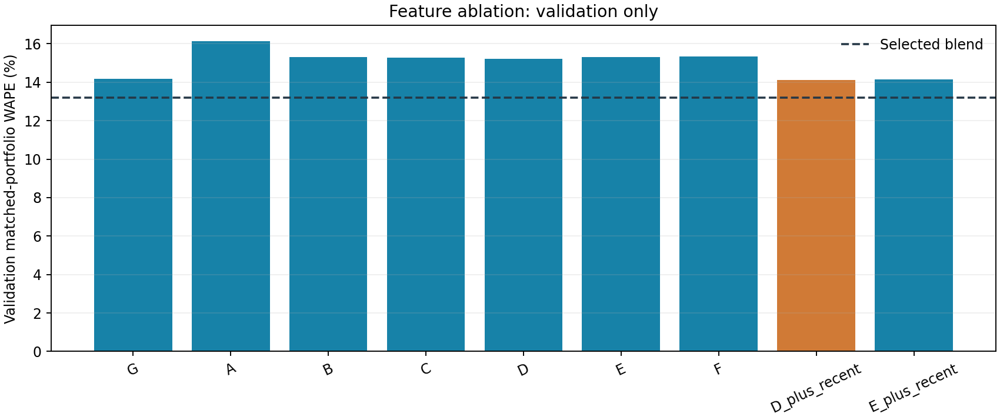
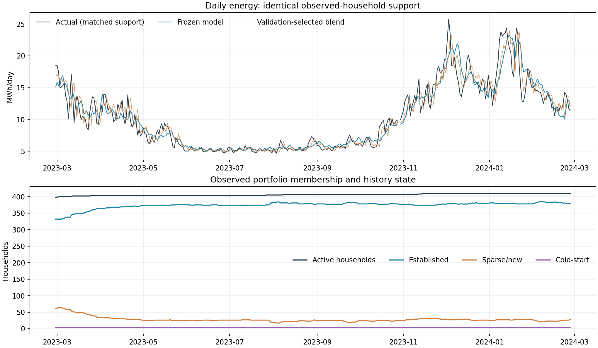
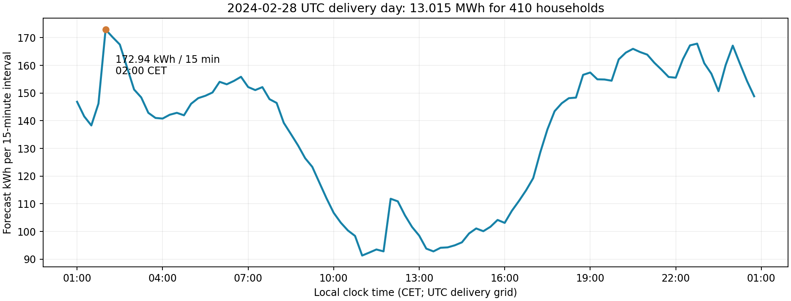

# Step 4: household demand forecasts and portfolio aggregation

Built one pooled household HistGradientBoostingRegressor and one separate history-free cold-start model. No forecast quantiles, uncertainty intervals or procurement optimisation were implemented. The existing data audit, date split and weather models were not redone. Step 2 feature definitions were executed in a vectorised batch backend, tested against the reference for cutoff/lag/window/DST equivalence.

Frozen UTC delivery dates: **TRAIN 2019-05-20–2022-02-27; VALIDATION 2022-02-28–2023-02-27; TEST 2023-02-28–2024-02-27**. Each forecast issues **11:00 Europe/Berlin on D−1**; only meter interval starts <= issue minus 30 minutes are used. UTC delivery days always have 96 intervals, local behavioural clocks use DST. Metadata remains conditional on the explicitly accepted fixed, undated-snapshot assumption.

## 1. Exact model input features

Selected primary feature set: **D_plus_recent**, 105 columns including explicit missing indicators. Household_ID is a key only; it is not a predictive or ordinal numerical feature. Actual target-day weather, target/source/quality flags, visits/protocols, retrospective coverage and fitted-model/source timestamps are excluded from inputs.

```text
LocalQuarterHourSlot
LocalHour
LocalWeekday
LocalWeekend
LocalMonth
LocalDayOfYear
HourSin
HourCos
DayOfYearSin
DayOfYearCos
ForecastLeadHours
LocalUTCOffsetMinutes
PreviousAvailableSameInterval
PreviousAvailableSameIntervalAgeHours
PreviousWeekSameLocalInterval
RecentSameSlot28dMedian
RecentSameSlot28dCount
Recent28dMean
Recent28dMedian
HistoricalHouseholdBaseline
HistoryObservedIntervals
HistoryExpectedIntervals
HistoryValidDays
HistoryMissingRate
HistoryAgeDaysAtForecast
GapAgeHours
Recent7dCoverage
Recent28dCoverage
PredictedTemperature
PredictedSunshine
PredictedHumidity
PredictedTemperatureMissing
PredictedSunshineMissing
PredictedHumidityMissing
HeatingExposure
Weather_ID
Survey_Building_LivingArea
Survey_Building_Residents
TemperatureLivingArea
HeatingExposureLivingArea
Survey_HeatPump_Installation_Type
Survey_HeatDistribution_System_FloorHeating
Survey_HeatDistribution_System_Radiator
Survey_DHW_Production_ByHeatPump
Survey_DHW_Production_ByElectricWaterHeater
Survey_DHW_Production_BySolar
TemperatureAirSource
TemperatureGroundSource
HeatingExposureAirSource
HeatingExposureGroundSource
ResidentsHeatPumpDHW
ResidentsElectricDHW
LocalQuarterHourSlot_missing
LocalHour_missing
LocalWeekday_missing
LocalMonth_missing
LocalDayOfYear_missing
HourSin_missing
HourCos_missing
DayOfYearSin_missing
DayOfYearCos_missing
ForecastLeadHours_missing
LocalUTCOffsetMinutes_missing
PreviousAvailableSameInterval_missing
PreviousAvailableSameIntervalAgeHours_missing
PreviousWeekSameLocalInterval_missing
RecentSameSlot28dMedian_missing
RecentSameSlot28dCount_missing
Recent28dMean_missing
Recent28dMedian_missing
HistoricalHouseholdBaseline_missing
HistoryObservedIntervals_missing
HistoryExpectedIntervals_missing
HistoryValidDays_missing
HistoryMissingRate_missing
HistoryAgeDaysAtForecast_missing
GapAgeHours_missing
Recent7dCoverage_missing
Recent28dCoverage_missing
Survey_Building_LivingArea_missing
Survey_Building_Residents_missing
Survey_HeatPump_Installation_Type_missing
Survey_HeatDistribution_System_FloorHeating_missing
Survey_HeatDistribution_System_Radiator_missing
Survey_DHW_Production_ByHeatPump_missing
Survey_DHW_Production_ByElectricWaterHeater_missing
Survey_DHW_Production_BySolar_missing
Recent7dMean
Recent7dMedian
Recent7dNightMean
Recent7dDayMean
Recent7dEveningMean
Recent7dPeak
Recent7dP95
RecentChangeRatio
Recent7dZeroFraction
Recent7dMean_missing
Recent7dMedian_missing
Recent7dNightMean_missing
Recent7dDayMean_missing
Recent7dEveningMean_missing
Recent7dPeak_missing
Recent7dP95_missing
RecentChangeRatio_missing
Recent7dZeroFraction_missing
```

The only target-day weather inputs are **PredictedTemperature, PredictedSunshine, PredictedHumidity** and their Missing indicators. Historical training weather forecasts are out-of-time expanding fits/warm-up baselines; validation uses training-only weather weights; test uses the locked test weather forecasts. All joins use issue timestamp + assigned Weather_ID + target UTC hour. Hourly weather covariates are repeated over four quarters with their original units, not summed as quarter-hour weather totals.

Metadata unknowns remain distinct from False (categorical code 2 vs 0; True=1). HP type and Weather_ID are native categories. Numeric metadata stays NaN where missing. Unknown technologies produce NaN interactions, not an absence assumption. Floor heating/radiators and DHW sources remain separate coexisting fields.

Small physical interactions investigated: temperature × area; heating exposure × area; temperature/heating exposure × air-source/ground-source flags; sunshine × PV, daytime and cyclic hour; residents × HP/electric DHW; EV × evening/night. HeatingExposure = max(0, **15°C − PredictedTemperature**), the existing fixed candidate base; no test tuning. PV/EV/appliance interactions were evaluated but not selected for the primary model. They remain in the cold-start model, which has no consumption history to represent identity.

## 2. Demand baseline results

A = previous available matching local quarter-hour; B = previous-week same local interval; C = recent same-slot 28-day median. Missing baseline values use the same training-only selected cold fallback, so comparisons cover identical observed target support. Raw baseline availability on validation: A 93.4%, B 89.7%, C 93.4%. Coverage is not inferred from future file summaries.

D = validation-selected blend, testing .25/.50/.75 pairwise weights and endpoints. Selected strongest baseline: **75% A + 25% B**. The weighting objective is matched-portfolio WAPE, household MAE tie-break.

| Candidate | HouseholdMAE | HouseholdRMSE | PortfolioWAPE | PortfolioBias | DailyEnergyMAE |
| --- | --- | --- | --- | --- | --- |
| baseline_A | 0.2069 | 0.3809 | 14.1239 | -0.2983 | 714.1793 |
| baseline_B | 0.2137 | 0.3841 | 18.9336 | 0.2536 | 1161.0445 |
| baseline_C | 0.1709 | 0.3214 | 27.4287 | -15.1577 | 1917.9632 |
| blend_A_B_0.25 | 0.1963 | 0.3435 | 15.9498 | 0.1156 | 947.1071 |
| blend_A_B_0.5 | 0.1899 | 0.3283 | 13.9325 | -0.0224 | 779.5840 |
| blend_A_B_0.75 | 0.1927 | 0.3417 | 13.2024 | -0.1603 | 688.4855 |
| blend_A_C_0.25 | 0.1698 | 0.3098 | 21.8191 | -11.4428 | 1490.0605 |
| blend_A_C_0.5 | 0.1762 | 0.3170 | 17.2182 | -7.7280 | 1096.3294 |
| blend_A_C_0.75 | 0.1884 | 0.3418 | 14.4154 | -4.0132 | 802.4888 |
| blend_B_C_0.25 | 0.1721 | 0.3125 | 23.5228 | -11.3049 | 1627.7257 |
| blend_B_C_0.5 | 0.1805 | 0.3212 | 20.5393 | -7.4521 | 1387.0173 |
| blend_B_C_0.75 | 0.1943 | 0.3461 | 18.8840 | -3.5992 | 1218.3996 |


## 3. Validation results

| Period | Method | Scope | n | MAE | RMSE | WAPE % | Bias |
| --- | --- | --- | --- | --- | --- | --- | --- |
| Validation | selected | Household | 8699070 | 0.1818 | 0.2904 | 59.3640 | 0.0010 |
| Validation | selected | MatchedPortfolio | 34887 | 10.7893 | 16.6054 | 14.1276 | 0.2585 |
| Validation | baseline | Household | 8699070 | 0.1927 | 0.3417 | 62.9030 | -0.0006 |
| Validation | baseline | MatchedPortfolio | 34887 | 10.0827 | 15.6565 | 13.2024 | -0.1603 |


Validation uses available labels only through **2023-02-27 09:30 UTC**: late final validation-day targets would not be known at first test issue and are embargoed. All candidate decisions used training + this validation subset only. The all-missing validation day **2022-10-30** is forecasted but not scored; daily accuracy covers 364 days. The last validation day's energy error covers only its pre-embargo observed support, not an invented complete actual day.

The model improves household error but the selected blend is stronger on validation portfolio WAPE and daily energy error. This matters for procurement: ML is not automatically the best aggregate forecast. The pooled model remains the requested household estimator; the blend remains a serious benchmark for the uncertainty/procurement stage. No test-based strategy reselection occurred.

## 4. Chosen model/configuration

HistGradientBoostingRegressor, one global pooled model, with categorical weather station/technology flags and no household-specific estimator:

```json
{
  "max_iter": 80,
  "learning_rate": 0.07,
  "max_leaf_nodes": 15,
  "min_samples_leaf": 200,
  "l2_regularization": 2.0,
  "early_stopping": false,
  "random_state": 42
}
```

No random internal time split: early_stopping=False. Training label thinning is deterministic, not a time split: one quarter-hour in alternating hours, rotating over eight days so every quarter/hour phase is represented. All flagged extremes are forced into the sample unchanged. All modelling rows remain materialised; validation/test are scored at full 15-minute resolution.

Training fit: **696,914 measured/reconstructed sample labels**, 169 supervised households, 628,314 established-history rows for cold-start learning. Refit: **1,785,052 train+validation sample labels**, 392 supervised households. Actual last refit label is **2023-02-27 07:45:00+00:00**, before the first test issue. Four targetless households never supply training labels.

## 5. Chosen loss and outlier policy

Both squared_error and absolute_error were compared on validation. **Squared error selected**: absolute error reduced individual MAE but materially underpredicted aggregate demand (validation full-G portfolio WAPE 24.75% vs squared error 14.18%). The practical objective is aggregate procurement volume, not individual MAE alone. Robustness comes from 200-sample leaves, L2 regularisation, historical medians/p95 and validation-selected features; this is not a claim that squared-error loss itself is robust.

**Primary policy: retain all genuinely measured extreme labels unchanged.** The 66.976 kWh training spike is included despite sampling; the 27.304 kWh test spike remains in scoring. No clipping or synthetic targets. Predictions alone are constrained nonnegative because grid import cannot be negative.

Validation diagnostic excludes flagged training labels only, holding features/validation targets fixed. Full-G portfolio WAPE changes from 14.1809% to 14.1623% (very small), and household MAE from 0.181829 to 0.181793 kWh. This limited sensitivity experiment does not remove historical spike effects from input summaries. The unverified meter/correction hypothesis is not enough to delete measured data.

## 6. Chosen feature set

**D + recent behaviour:** calendar; allowed demand lags and 28-day profile; expanding baseline/quality/age; predicted weather; area/residents; HP/heating/DHW metadata; recent seven-day means/medians, night/day/evening, peak/p95, change ratio and zero fraction.

PV ownership, EV, dryer/freezer and their explicit interactions did not add validation portfolio skill to this recent-behaviour design and were omitted from the primary. This is a feature-group result for this estimator/sample/benchmark, not proof these technologies have no physical effect. Recent measured behaviour can already represent PV/EV changes better than undated ownership flags. Cold fallback still uses those metadata groups because its personal history is deliberately unavailable.

## 7. Train/validation ablation

A historical core + calendar/quality; B adds predicted weather; C adds area/residents; D adds HP/heating/DHW; E adds PV; F adds EV/appliances; G adds seven-day recent behaviour/change. D_plus_recent and E_plus_recent retain mandatory recent behaviour while testing optional ownership groups. All use the selected loss/configuration; this is not a huge parameter search.

| Candidate | HouseholdMAE | HouseholdRMSE | PortfolioWAPE | DailyEnergyMAE |
| --- | --- | --- | --- | --- |
| G | 0.1818 | 0.2904 | 14.1809 | 810.2314 |
| A | 0.1840 | 0.2936 | 16.1447 | 988.3611 |
| B | 0.1829 | 0.2927 | 15.3213 | 915.4791 |
| C | 0.1831 | 0.2926 | 15.2821 | 909.9235 |
| D | 0.1830 | 0.2925 | 15.2232 | 906.5681 |
| E | 0.1832 | 0.2925 | 15.3171 | 913.4915 |
| F | 0.1832 | 0.2926 | 15.3237 | 912.7672 |
| D_plus_recent | 0.1818 | 0.2904 | 14.1276 | 807.1461 |
| E_plus_recent | 0.1818 | 0.2904 | 14.1423 | 807.0250 |
| G_extreme_excluded_diagnostic | 0.1818 | 0.2905 | 14.1623 | 807.7970 |




Predicted weather improved validation portfolio WAPE over A; most further gain comes from recent behaviour. PV/EV group differences are small and confounded by shared features, coverage and metadata age. No causal effect sizes are estimated.

## 8. Final locked test MAE/RMSE/WAPE/Bias

| Period | Method | Scope | n | MAE | RMSE | WAPE % | Bias |
| --- | --- | --- | --- | --- | --- | --- | --- |
| Test | selected | Household | 13320864 | 0.1729 | 0.2847 | 61.4397 | 0.0010 |
| Test | selected | MatchedPortfolio | 34944 | 15.3308 | 21.8259 | 14.2942 | 0.3948 |
| Test | baseline | Household | 13320864 | 0.1872 | 0.3393 | 66.5410 | 0.0010 |
| Test | baseline | MatchedPortfolio | 34944 | 15.5184 | 22.4534 | 14.4691 | 0.3783 |


Household units: kWh per household quarter-hour. Portfolio units: kWh per matched-support quarter-hour. WAPE is 100 × sum(abs(error)) / sum(abs(actual)); Bias is mean(predicted−actual), positive means overforecast. Scores pool observed intervals, not unweighted household percentages. Undefined zero-denominator WAPE remains missing.

**365 daily forecasts issued, 364 days scoreable.** All targets are unavailable on **2023-10-29**. Its 406-household full forecast exists, but matched actual/error are NaN. No fabricated zero-error day. Interval accuracy covers 34,944 intervals and 13,320,864 observed household targets.

Weights are refitted once on train+validation, then frozen. Test date D reads only input columns, predicts all active household intervals, and only then reads D labels for scores. Recent consumption from earlier test days is allowed as an input at the cutoff. No model fitting occurs inside the daily loop. Model-file SHA256 hashes are unchanged through test, independent validation and the unseen-day demonstration. Test errors were not used to change loss, feature set, blend, base temperature or outlier policy. Earlier raw-data and weather investigations had inspected parts of this historical period; it is held out from energy model selection, not a claim that raw files were never inspected.

## 9. Daily total-energy error

Absolute(sum(predictions)−sum(actual)) over exactly the same known household/interval support each day:

| Period | Method | DaysWithActualSupport | DailyTotalMAE_kWh | MedianDailyAE_kWh |
| --- | --- | --- | --- | --- |
| Validation | selected | 364 | 807.1461 | 423.7607 |
| Validation | baseline | 364 | 688.4855 | 369.6880 |
| Test | selected | 364 | 1148.0899 | 706.6679 |
| Test | baseline | 364 | 1108.5886 | 676.3637 |


This is not sum of absolute quarter-hour errors. Missing-household actuals remain absent from both matched sums. A whole day without any actual support has undefined error. Because support can change within a day, these totals describe measured support, not a complete 410-household energy truth.

## 10. Improvement versus the strongest baseline

| Scope | Metric | Improvement % |
| --- | --- | --- |
| Household | MAE | 7.6665 |
| Household | RMSE | 16.0873 |
| Household | WAPE | 7.6665 |
| MatchedPortfolio | MAE | 1.2087 |
| MatchedPortfolio | RMSE | 2.7947 |
| MatchedPortfolio | WAPE | 1.2087 |
| Daily matched energy | MAE | -3.5632 |


Positive is improvement. The model improves test household MAE/RMSE and slightly improves quarter-hour portfolio errors. **Daily total-energy MAE is worse than the blend**, and validation aggregate performance also favoured the blend. Those limitations should be carried into the next step rather than hiding them behind one favourable metric.

## 11. Subgroup performance

| Group | Value | n | MAE | RMSE | WAPE | Bias | ActualEnergy |
| --- | --- | --- | --- | --- | --- | --- | --- |
| PV | True | 4172928 | 0.1693 | 0.3008 | 68.3767 | 0.0013 | 1033497.9030 |
| PV | Unknown | 5539200 | 0.1700 | 0.2717 | 58.0359 | 0.0015 | 1622733.5150 |
| PV | False | 3608736 | 0.1813 | 0.2851 | 59.9319 | -0.0000 | 1091572.9930 |
| HPType | ground-source | 5118048 | 0.1641 | 0.2733 | 61.9840 | 0.0016 | 1355238.4670 |
| HPType | air-source | 7597248 | 0.1764 | 0.2903 | 60.6254 | 0.0007 | 2210398.7470 |
| HPType | Unknown | 605568 | 0.2024 | 0.3069 | 67.2707 | 0.0002 | 182167.1970 |
| EV | False | 6517824 | 0.1571 | 0.2466 | 59.2174 | 0.0038 | 1728900.7610 |
| EV | Unknown | 4136160 | 0.1747 | 0.2817 | 61.8378 | 0.0008 | 1168808.8510 |
| EV | True | 2666880 | 0.2085 | 0.3649 | 65.4121 | -0.0055 | 850094.7990 |
| ForecastState | sparse/new | 271488 | 0.2091 | 0.3068 | 67.5409 | 0.0067 | 84067.8890 |
| ForecastState | established | 13049376 | 0.1721 | 0.2842 | 61.2997 | 0.0009 | 3663736.5220 |
| ForecastState | cold-start | 0 | Not scoreable | Not scoreable | Not scoreable | Not scoreable | 0.0000 |
| Weather_ID | 8jB | 5879424 | 0.1728 | 0.2880 | 60.3532 | 0.0006 | 1683379.3990 |
| Weather_ID | Hg | 5021280 | 0.1654 | 0.2738 | 60.4366 | 0.0015 | 1374447.0220 |
| Weather_ID | z6I | 465984 | 0.2072 | 0.3215 | 66.5357 | -0.0051 | 145080.2420 |
| Weather_ID | wDD | 523392 | 0.1883 | 0.3082 | 64.8579 | 0.0028 | 151947.1360 |
| Weather_ID | MqO | 515616 | 0.2299 | 0.3490 | 70.4632 | -0.0009 | 168231.8810 |
| Weather_ID | HbsbG | 441408 | 0.1694 | 0.2537 | 60.8245 | 0.0016 | 122939.1480 |
| Weather_ID | sV3mR | 301920 | 0.1472 | 0.2292 | 62.5110 | 0.0047 | 71081.9460 |
| Weather_ID | ceOxS | 171840 | 0.1348 | 0.2485 | 75.4617 | 0.0103 | 30697.6370 |
| SunshineAvailable | Available | 12405696 | 0.1741 | 0.2874 | 61.3174 | 0.0008 | 3523085.6800 |
| SunshineAvailable | Unavailable | 915168 | 0.1556 | 0.2449 | 63.3575 | 0.0043 | 224718.7310 |
| HeatPumpDHW | Unknown | 4746240 | 0.1783 | 0.2929 | 61.9364 | 0.0030 | 1366214.4080 |
| HeatPumpDHW | True | 8574624 | 0.1699 | 0.2801 | 61.1548 | -0.0000 | 2381590.0030 |
| ElectricDHW | True | 3656640 | 0.1762 | 0.2909 | 61.5035 | 0.0034 | 1047422.1020 |
| ElectricDHW | Unknown | 9664224 | 0.1716 | 0.2823 | 61.4150 | 0.0001 | 2700382.3090 |
| SolarDHW | Unknown | 12856800 | 0.1725 | 0.2837 | 61.5170 | 0.0010 | 3604201.6590 |
| SolarDHW | True | 464064 | 0.1841 | 0.3105 | 59.5002 | 0.0030 | 143602.7520 |
| Season | DJF | 3324864 | 0.2518 | 0.3588 | 56.6629 | 0.0051 | 1477243.3280 |
| LivingAreaBand | 200-300 | 2880768 | 0.2041 | 0.3390 | 60.1579 | -0.0041 | 977320.3030 |
| LivingAreaBand | <=150 | 3457728 | 0.1582 | 0.2531 | 64.2354 | 0.0037 | 851618.2510 |
| LivingAreaBand | 150-200 | 5569440 | 0.1539 | 0.2529 | 60.2637 | 0.0029 | 1422071.8910 |
| LivingAreaBand | >300 | 606048 | 0.2598 | 0.4086 | 57.2688 | -0.0066 | 274927.7400 |
| LivingAreaBand | Unknown | 806880 | 0.1899 | 0.2941 | 69.0608 | 0.0008 | 221866.2260 |
| PredictedTemperatureBand | <=0 | 544708 | 0.2814 | 0.3918 | 48.4111 | -0.0089 | 316642.3660 |
| PredictedTemperatureBand | 0-5 | 2511212 | 0.2521 | 0.3570 | 56.6171 | 0.0014 | 1118232.4130 |
| PredictedTemperatureBand | 5-10 | 3421308 | 0.2172 | 0.3215 | 64.8223 | -0.0002 | 1146343.5970 |
| Season | MAM | 3316320 | 0.1863 | 0.2889 | 66.1817 | 0.0041 | 933739.0640 |
| PredictedTemperatureBand | 10-15 | 2549092 | 0.1418 | 0.2471 | 68.7920 | 0.0001 | 525587.4350 |
| PredictedTemperatureBand | 15-20 | 2349044 | 0.0983 | 0.2004 | 63.2697 | 0.0051 | 364969.0700 |
| PredictedTemperatureBand | >20 | 1945500 | 0.0929 | 0.1930 | 65.4554 | 0.0019 | 276029.5300 |
| Season | JJA | 3365664 | 0.0906 | 0.1922 | 61.8241 | 0.0010 | 493032.1790 |
| Season | SON | 3314016 | 0.1638 | 0.2750 | 64.3305 | -0.0060 | 843789.8400 |


These are descriptive test scores, not causal comparisons. WAPE can rise for low-import/PV households because its denominator is smaller. Groups differ in size, weather, area, occupancy, history coverage and label availability. HP Unknown and metadata-missing groups may be less stable. EV peaks are less predictable; metadata ownership does not specify a charging schedule. Actual target-day weather is not used for temperature-band grouping—bands use PredictedTemperature.

## 12. Established / sparse / cold-start

| Group | Value | n | MAE | RMSE | WAPE | Bias | ActualEnergy |
| --- | --- | --- | --- | --- | --- | --- | --- |
| ForecastState | sparse/new | 271488 | 0.2091 | 0.3068 | 67.5409 | 0.0067 | 84067.8890 |
| ForecastState | established | 13049376 | 0.1721 | 0.2842 | 61.2997 | 0.0009 | 3663736.5220 |
| ForecastState | cold-start | 0 | Not scoreable | Not scoreable | Not scoreable | Not scoreable | 0.0000 |


Established uses the existing Step 2 rule (>=28 valid completed UTC days, >=80% 28-day coverage, <=48h cutoff gap). Sparse/new includes later entrants and stale histories. Cold-start means no valid historical Total, not necessarily a physically new dwelling.

Four targetless households—1065698, 747511, 768498, 996610—receive 96 forecasts each through the separate history-free model. It trains on established training households with all personal demand histories withheld. Cold predictors are metadata/calendar/predicted weather and physical interactions only. Their real accuracy is **unknown**, not zero. Proxy tests deliberately hide histories of labelled households: selected cold test proxy household MAE 0.2241 kWh and matched-portfolio WAPE 16.89%. This proxy does not prove accuracy for those four targetless homes.

## 13. Active households over time

A household enters only once its first supplied record is available by issue (`FirstObservedTimestamp+30min <= ForecastIssueTimestamp`). Before that, no historical portfolio prediction is attributed to it. HistoryAgeDaysAtForecast is computed only after known membership. Once active, it stays active because no confirmed departures are provided; a missing/stopped meter is not retrospective proof of departure.

Test active roster grows **397 → 410**, range 397–410. Households unseen in TRAIN grow **228 → 241**; they are retained. Refit has 392 supervised households, and new post-refit entrants still receive global/history-free forecasts as appropriate. First supplied-date membership is a proxy for the observed portfolio, not a verified contract start date.



Exact daily roster/state counts are in active_households_by_day.csv; all-period membership counts in active_roster_all_periods.csv. The first supply day may have observed labels but no prior forecast-issue membership; those retrospective labels are not scored as if that household were known beforehand.

## 14. Matched support versus full forecast

**Matched evaluation:** at t, only active households with finite actual Total contribute to both predicted and actual sums. **Full forecast:** all active households contribute, including normal/sparse/cold fallback. Both series are saved together with ActiveCount, ObservedCount and FullActualKnown. FullActual is NaN when any active actual is missing. The full-portfolio ground truth is unknown for all test intervals; matched metrics must not be labelled full-portfolio accuracy.

## 15. Important failure modes

- Household WAPE remains ~61%, despite lower absolute/RMS error: quarter-hour HP cycling and intermittent EV/appliance use are difficult with no schedules/setpoints. Forecasts smooth peaks.
- Weather is itself forecasted with ~2.5°C temperature error; station-wide errors can correlate many household heating errors and survive portfolio aggregation.
- Cold estimates lack individual calibration; four real targetless cases cannot be scored. Sparse/stale source history is weaker than established history.
- Metadata has no effective dates; ownership/residents may be outdated. Country/timezone and observation arrival latency are assumptions inherited from previous steps.
- Raw periods include whole missing DST-transition dates; no actual day error can be inferred there. UTC delivery days and local procurement settlement days differ at DST.
- No departure dates: stale meters remain active, so operational full totals can include unverified members. Confirm the portfolio roster before real procurement.
- Deterministic 1/8 fitting is a computational compromise; it preserves all slots/dates/households and extremes but is not full-row training. Ablations describe this configuration. Feature gains are modest and no single algorithm dominates all metrics.
- The blend was better on validation aggregate/daily metrics and still wins daily totals on test. Do not claim ML is universally superior or use test results to retune it.

## 16. Saved predictions / reproducibility

- `predictions/test/<date>.parquet`: 365 frozen daily household forecast files, no actual target columns.
- `predictions/test_portfolio.parquet`: matched + full forecast series and support counts, actuals only where known.
- `evaluation/test_labels/<date>.parquet`: actual targets/provenance/extreme flags, separated from predictors.
- `predictions/validation/<date>.parquet`: training-only selected-model forecasts; `evaluation/validation_residuals/` stores known actuals/residuals separately for a later uncertainty step. No intervals/quantiles have been calibrated here.
- `predictions/2024-02-28_households.parquet` and `.csv`; `2024-02-28_portfolio.csv`; `2024-02-28_group_contributions.csv`.
- `models/locked_primary.pkl`, `locked_cold.pkl`; validation-only analysis copies are separate and cannot alter the locked demonstration weights.
- `data/<period>/<household>.parquet` and `daily/<period>/<date>.parquet`: materialised Step 2-equivalent tables with predicted weather only. Raw data and old artifacts remain intact.
- `model_selection_lock.json`, `fit_training_summary.json`, `refit_summary.json`, `validation_checks.json`, `evaluation/validation_comparison.csv`, `evaluation/subgroup_metrics.csv`, `evaluation/test_daily_energy.csv`.

**Checks:** 24 automated tests passed (reference equivalence, future poisoning, gaps, DST, cohort membership, unknown interactions, sampling/extreme preservation and matched-support scores plus prior weather/preprocessing tests). Independent checks validated all test grids/prediction-label keys/support, unchanged locked hashes, 410×96 final-day outputs and three real household future-poison/reproduction cases. No after-cutoff target/weather input or synthetic training labels were introduced. Source weather selection-lock SHA is preserved.

## 17. 2024-02-28 total predicted energy

**13014.909 kWh = 13.015 MWh**, all 410 active households / 39,360 quarter-hour rows. Same locked energy and cold weights as test—no test-target refit. Consumption is limited to the 2024-02-27 meter cutoff (09:30 UTC), weather is the saved 2024-02-28 forecast, metadata is the same accepted snapshot. No smart-meter target is supplied for this day, so no demand accuracy is calculated.

| Group | Value | Households | DailyEnergyKWh |
| --- | --- | --- | --- |
| Installation_HasPVSystem | False | 114 | 3965.7183 |
| Installation_HasPVSystem | True | 131 | 3550.1815 |
| Installation_HasPVSystem | Unknown | 165 | 5499.0088 |
| Survey_HeatPump_Installation_Type | Unknown | 19 | 664.7650 |
| Survey_HeatPump_Installation_Type | air-source | 235 | 7741.3366 |
| Survey_HeatPump_Installation_Type | ground-source | 156 | 4608.8071 |
| ForecastState | cold-start | 4 | 148.0689 |
| ForecastState | established | 378 | 12306.2976 |
| ForecastState | sparse/new | 28 | 560.5421 |


## 18. 2024-02-28 peak

Maximum forecast quarter-hour: **172.941 kWh**, interval start **2024-02-28 01:00:00+00:00 = 2024-02-28 02:00:00+01:00**. Average power for that interval is **691.765 kW**. This is a predicted peak, not a measured outcome; interval-start semantics follow the existing assumption.



## 19. Readiness for uncertainty/procurement work

**YES for the next modelling step:** reproducible frozen point forecasts, a strong validation-selected baseline, separate actuals, honest support counts and training-only validation residuals are available. No P10/P50/P90, price assumptions or procurement optimisation are implemented. This is not production procurement approval: the next step must preserve temporal calibration, model correlated weather/household residuals, account for missing/cold/stale support, and retain the blend as a competing point forecast. Real full-portfolio coverage cannot be validated without missing targets/roster confirmation.

**READY FOR UNCERTAINTY/PROCUREMENT STEP: YES**
