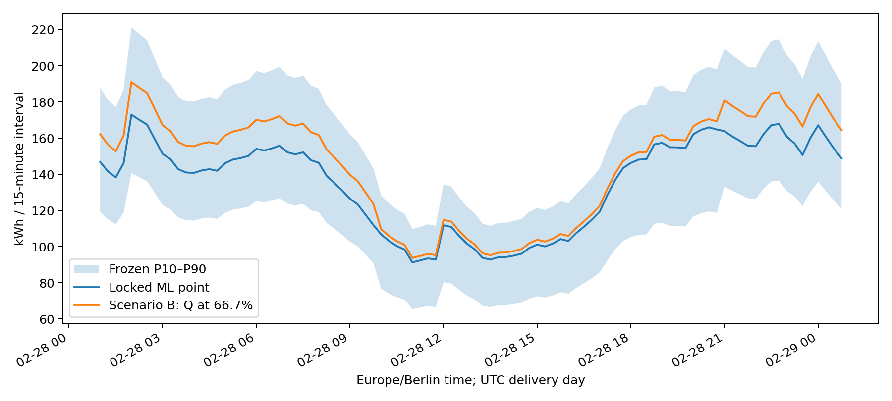
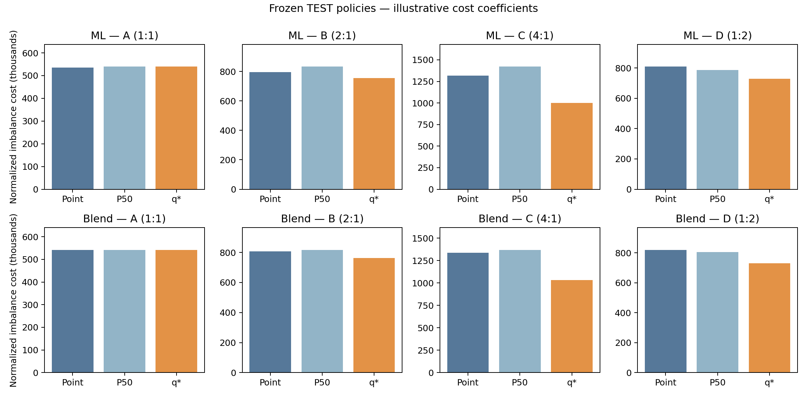

# Step 6 — provisional procurement decision support

**PROVISIONAL PROCUREMENT DECISION-SUPPORT DEMONSTRATION. No production procurement approval.**

For shortage demand D>Q, loss is C_under × (D−Q); for surplus Q>D, loss is C_over × (Q−D). Minimizing expected linear imbalance loss gives q*=C_under/(C_under+C_over), hence Q=F⁻¹(q*). Atoms can admit multiple minimizers; empirical sample quantiles use the same NumPy linear convention as Step 5. With discrete calibration samples, linear interpolation need not minimize raw finite-sample empirical loss exactly; it preserves the frozen quantile convention. This rule assumes demand uncertainty independent of the procurement action and constant marginal costs, without a separately modelled purchase-price term or constraints.

Cost units: **normalized hypothetical cost units per kWh**. Defaults are illustrative normalized coefficients, not actual E.ON prices or monetary savings. A JSON scenario list and `--cost-units` allow later supplied cost coefficients to replace them. No tariffs were fetched or inferred.

| Scenario | Under | Over | q* |
|---|---:|---:|---:|
| A — Symmetric | 1 | 1 | 0.500000 |
| B — Shortage twice surplus | 2 | 1 | 0.666667 |
| C — Shortage four times surplus | 4 | 1 | 0.800000 |
| D — Surplus twice shortage | 1 | 2 | 0.333333 |

The exact fractions 1/3 and 2/3 are used despite the P33/P67 column labels. Equal costs call for median demand; more expensive shortage calls for a higher quantile, and more expensive surplus for a lower quantile. P90 is not automatically the safe or optimal purchase: it corresponds to a 9:1 shortage/surplus cost ratio under this loss.

Requested quantiles come directly from Step 5 validation-locked empirical residual distributions. ML retains its locked temperature-band conditioning; Blend retains pooled calibration. Full forecasts keep the same aligned targetless-household proxy addition. Complete daily residual sums provide separate daily quantiles. Existing Point/P10/P50/P90 are reproduced numerically and preserved; no models, features, splits or uncertainty intervals are modified. The policy/provenance lock is written before TEST evaluation.

## Frozen TEST economic evaluation

Scoring covers 34,944 supported quarter-hours and 364 daily observations. Actual demand and each policy are restricted to the same retrospectively measured household subset. Full portfolio ground truth is incomplete, so these costs are not verified full-portfolio costs. The zero-support day is excluded, not treated as zero demand. One daily observation sums only matched measurements at each interval; the household subset can change within a day.

The persistence benchmark uses previous-available same-interval demand for each household, with its frozen Blend point as fallback where the lag is missing. This is an explicitly fallback-completed persistence benchmark, not an additional trained model.

| Scenario | Method | Policy | Total normalized cost | Shortage MWh | Surplus MWh | Shortage % | Mean deviation kWh |
|---|---|---|---:|---:|---:|---:|---:|
| A | ML | PointForecast | 535,720.3 | 260.96 | 274.76 | 44.5 | 15.33 |
| A | ML | P50 | 540,430.9 | 294.48 | 245.95 | 53.5 | 15.47 |
| A | ML | CostOptimalQuantile | 540,430.9 | 294.48 | 245.95 | 53.5 | 15.47 |
| A | Persistence | Persistence | 580,962.3 | 284.52 | 296.44 | 49.3 | 16.63 |
| B | ML | PointForecast | 796,681.6 | 260.96 | 274.76 | 44.5 | 15.33 |
| B | ML | P50 | 834,908.8 | 294.48 | 245.95 | 53.5 | 15.47 |
| B | ML | CostOptimalQuantile | 755,213.1 | 183.41 | 388.40 | 38.3 | 16.36 |
| B | Persistence | Persistence | 865,484.1 | 284.52 | 296.44 | 49.3 | 16.63 |
| C | ML | PointForecast | 1,318,604.2 | 260.96 | 274.76 | 44.5 | 15.33 |
| C | ML | P50 | 1,423,864.7 | 294.48 | 245.95 | 53.5 | 15.47 |
| C | ML | CostOptimalQuantile | 1,000,926.4 | 103.88 | 585.42 | 23.9 | 19.73 |
| C | Persistence | Persistence | 1,434,527.8 | 284.52 | 296.44 | 49.3 | 16.63 |
| D | ML | PointForecast | 810,479.2 | 260.96 | 274.76 | 44.5 | 15.33 |
| D | ML | P50 | 786,383.8 | 294.48 | 245.95 | 53.5 | 15.47 |
| D | ML | CostOptimalQuantile | 729,328.9 | 448.68 | 140.32 | 69.4 | 16.86 |
| D | Persistence | Persistence | 877,402.7 | 284.52 | 296.44 | 49.3 | 16.63 |
| A | Blend | PointForecast | 542,274.6 | 264.53 | 277.75 | 48.4 | 15.52 |
| A | Blend | P50 | 541,139.9 | 276.52 | 264.62 | 50.1 | 15.49 |
| A | Blend | CostOptimalQuantile | 541,139.9 | 276.52 | 264.62 | 50.1 | 15.49 |
| B | Blend | PointForecast | 806,801.8 | 264.53 | 277.75 | 48.4 | 15.52 |
| B | Blend | P50 | 817,659.5 | 276.52 | 264.62 | 50.1 | 15.49 |
| B | Blend | CostOptimalQuantile | 763,179.1 | 174.93 | 413.33 | 34.1 | 16.83 |
| C | Blend | PointForecast | 1,335,856.2 | 264.53 | 277.75 | 48.4 | 15.52 |
| C | Blend | P50 | 1,370,698.8 | 276.52 | 264.62 | 50.1 | 15.49 |
| C | Blend | CostOptimalQuantile | 1,030,931.4 | 104.89 | 611.38 | 21.4 | 20.50 |
| D | Blend | PointForecast | 820,021.9 | 264.53 | 277.75 | 48.4 | 15.52 |
| D | Blend | P50 | 805,760.1 | 276.52 | 264.62 | 50.1 | 15.49 |
| D | Blend | CostOptimalQuantile | 731,053.1 | 408.63 | 161.21 | 65.7 | 16.31 |

Daily metrics use separately calibrated daily procurement and **net daily** shortage/surplus. They are not the sum of interval imbalance costs: surplus at one time cannot offset shortage at another in interval settlement. Full observation counts, shortage counts, daily costs and deviations are in test_policy_metrics.csv; per-observation evaluations are also saved.

| Scenario | Method | Interval cost reduction vs point | Daily cost reduction vs point |
|---|---|---:|---:|
| A | Blend | 0.21% | 0.37% |
| A | ML | -0.88% | -2.00% |
| B | Blend | 5.41% | 5.29% |
| B | ML | 5.21% | 5.91% |
| C | Blend | 22.83% | 23.06% |
| C | ML | 24.09% | 26.22% |
| D | Blend | 10.85% | 10.80% |
| D | ML | 10.01% | 9.78% |

Negative reduction means quantile procurement cost more than point procurement on this TEST set. These are retrospective normalized results; no scenario, quantile or forecasting method was selected or changed from them. Expected-loss optimality under a forecast distribution does not guarantee lower realized TEST costs when calibration undercovers or demand shifts.

## February 28, 2024 — true unseen demonstration

Locked ML daily point: 13.014909 MWh; P10/P50/P90: 10.470 / 12.381 / 14.681 MWh. Locked Blend daily point: 12.714074 MWh; P10/P50/P90: 10.959 / 12.641 / 14.444 MWh. No actual demand is available for this day; realized costs cannot be claimed.

| Scenario | q* | ML daily Q MWh | Blend daily Q MWh | ML sum interval Q MWh | Blend sum interval Q MWh |
|---|---:|---:|---:|---:|---:|
| A | 0.500000 | 12.381 | 12.641 | 13.047 | 12.609 |
| B | 0.666667 | 13.195 | 13.171 | 13.971 | 13.462 |
| C | 0.800000 | 14.011 | 13.759 | 14.998 | 14.375 |
| D | 0.333333 | 11.679 | 12.169 | 12.104 | 11.812 |

The daily purchase and sum of interval quantities are distinct hypothetical decisions. Quantiles of sums generally differ from sums of marginal quantiles because errors correlate over time. The daily residual distribution is calibrated independently. They are not a jointly reconciled execution schedule: choose the appropriate settlement objective, and add reconciliation/constraints before attempting both simultaneously.

The locked ML peak is **2024-02-28 02:00 Europe/Berlin (01:00 UTC)**: point 172.94 kWh/15-min and P90 221.24 kWh/15-min. All following policies refer to that same timestamp, including Blend. No kWh value is presented as power; average kW would be four times interval kWh.

| Scenario | ML peak procurement kWh/15-min | Blend at ML peak kWh/15-min |
|---|---:|---:|
| A | 179.27 | 178.86 |
| B | 191.04 | 190.93 |
| C | 204.89 | 203.85 |
| D | 167.63 | 167.57 |

## Outputs and limitations

96-row schedules: 2024-02-28_ML_procurement_schedule.csv and 2024-02-28_Blend_procurement_schedule.csv. Daily decisions: 2024-02-28_daily_procurement.csv. Peak decisions: 2024-02-28_peak_procurement.csv. Evaluation: test_policy_metrics.csv, value_of_uncertainty.csv, test_interval_policy_evaluation.parquet and test_daily_policy_evaluation.csv. Locks/checks: decision_policy_lock.json and validation_checks.json. Figures: figures/2024-02-28_procurement.png and figures/test_policy_costs.png. Source: src/procurement_support.py.

Quarter-hour P10–P90 TEST coverage is 79.0% for ML and 77.0% for Blend; daily coverage is 73.4% and 74.5%, below nominal 80%. Spring coverage is weaker. Intervals were not widened. Four targetless households have provisional uncertainty; their common-shock proxy averaging may understate idiosyncratic variation. Actual full-portfolio ground truth is incomplete. No market liquidity, bid blocks, gate closure, transaction fees, intraday correction or market-price forecasting is modelled. The 96 intervals represent a UTC delivery day, displayed in Europe/Berlin local time. No orders are transmitted.

Confirmed: frozen-artifact hashes are unchanged and Step 5 quantiles are reproduced. Exploratory evidence: the TEST cost comparisons describe this historical matched subset. Modelling hypothesis: the empirical distribution and illustrative cost asymmetry approximate tomorrow’s demand and loss sufficiently for a demonstration; they do not establish deployable procurement optimality.

The completed forecast → uncertainty → asymmetric-cost policy pipeline is ready to present at the hackathon with these limitations prominently shown. It is a procurement decision-support prototype, not a production trading system.

READY FOR HACKATHON PRESENTATION: YES
